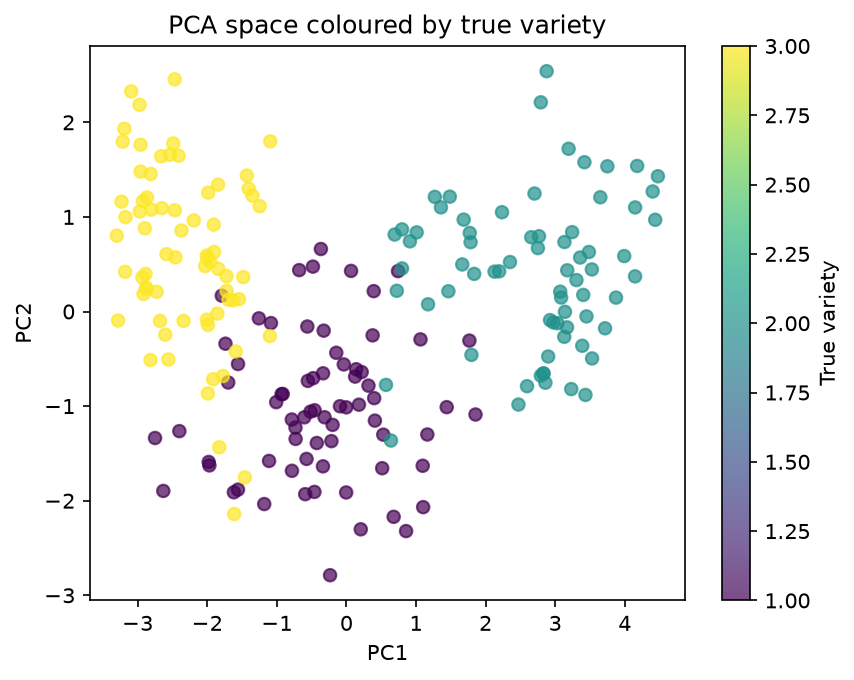
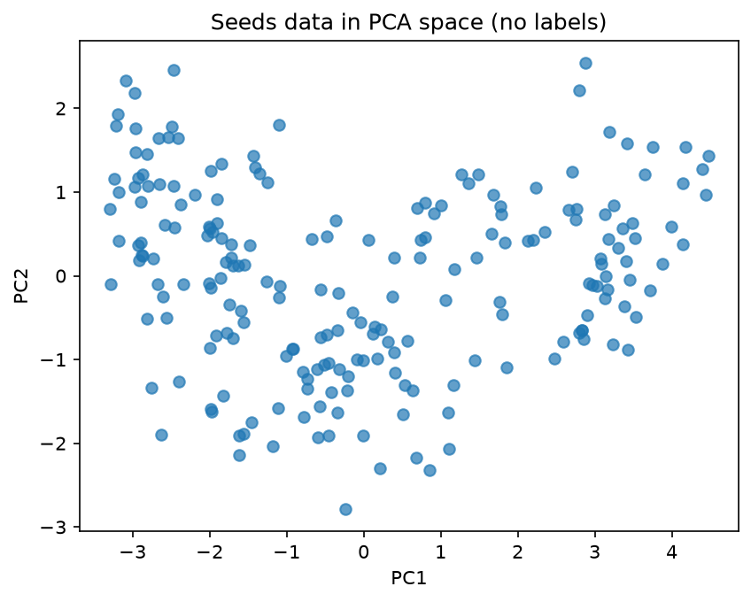
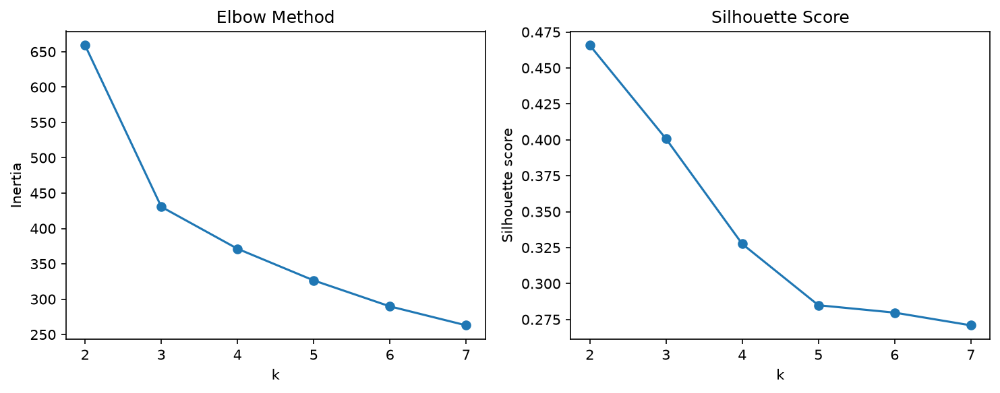

### Clustering wheat kernels with PCA and K-Means

**Author:** Panagiotis Tatoulis
I take 210 wheat kernels described by seven measurements, hide their variety labels, and use clustering alone to find out how many varieties are plausibly present and how cleanly they separate. Only at the end do I bring the labels back, as an answer key.

| Key results |
|---|
| **89% of the variation with two PCA components** |
| **Clusters: 3** |
|  **Purity: 0.919** |
| **Varieties 2 and 3 clearly separated.** |

---

## 1. Problem

An agricultural co-op receives deliveries of mixed wheat grain and suspects they contain several varieties, but the deliveries arrive unlabelled. Before paying for a labelling or sorting process, the co-op wants to know **how many varieties are plausibly present** and **how cleanly they separate** on a few simple measurements. The central question of the project is to find how much of the real class structure can clustering recover without using the labels. It is an unsupervised learning clustering problem.

## 2. Data

The data consist of 210 wheat kernels with seven measurements per kernel, namely area, perimeter, compactness, kernel length, kernel width, asymmetry, groove length. 

## 3. Method

This problem follows the same logic as Module 4 of the course and needs the following steps: Data loading, pre-processing, exploring with PCA, select the number of clusters, K-means clustering, and result evaluation against the labels. Some more details follow: 

1. **Scaling.** K-Means works with distances, so a feature measured on a large scale (such as area) would count more than a small one (such as compactness). `StandardScaler` puts all seven features on the same footing (mean 0, standard deviation 1).
2. **Exploring with PCA.** Seven dimensions plots are not visualisable, so they were reduced into two principal components and a single-colour scatter plot was drawn to investigate the shape of the data before any clustering.
3. **Choosing the number of clusters.** K-Means-based fitting for k = 2 to 7 (`n_init=10`, `random_state=42`) and two diagnostics were compared:
   - the **elbow method**: inertia against k, looking for where adding a cluster stops paying off
   - the **silhouette score**: how much closer each kernel is to its own cluster than to the nearest other one.
4. **Clustering.** K-Means with the chosen k on all seven scaled features.
5. **Evaluation against the labels.**
   - a **cross-tabulation** of clusters against varieties;
   - the **purity score**: the share of kernels that belong to their cluster's majority variety;
   - the PCA scatter **coloured by the true variety**;
   - **cluster profiles**: the cluster centres converted back to the original units.

The tools that were used are Python 3.14, pandas, scikit-learn, matplotlib, and Jupyter.

## 4. Results

### What the data looks like before clustering

The first two principal components capture 72% and 17% of the variation (89% total), so the 2D view is a good visual representation of structure. It shows three loose groups along PC1 (left, lower middle and right), which run into each other rather than being separated by clear gaps.

### Choosing k: the elbow and the silhouette disagree

| k | 2 | 3 | 4 | 5 | 6 | 7 |
|---|---|---|---|---|---|---|
| Inertia | 659.2 | 430.7 | 371.3 | 326.5 | 289.8 | 263.0 |
| Silhouette | **0.466** | 0.401 | 0.328 | 0.285 | 0.280 | 0.271 |

The elbow is clearly at **k = 3**: going from two to three clusters removes 229 units of inertia, and every later step removes only 27 to 59. The silhouette is highest at **k = 2**, but still reasonable at k = 3 before dropping sharply. The value **k = 3** was selected, because the elbow is sharp and the PCA scatter plot already showed three groups. The resulting clusters hold 72, 67 and 71 kernels.

### How well the clusters match the real varieties

| Cluster | Variety 1 | Variety 2 | Variety 3 | Cluster purity |
|---|---|---|---|---|
| 0 | 6 | 0 | **66** | 92% |
| 1 | 2 | **65** | 0 | 97% |
| 2 | **62** | 5 | 4 | 87% |

- The overall purity is 0.919 with 193 of the 210 kernels sitting in a cluster where their own variety dominates, while 17 do not.
- Every mistake involves variety 1 while varieties 2 and 3 are never mixed with each other. Variety 1 is mixed up with variety 3 for 10 kernels and with variety 2 for 7.

The colored scatter plot at the top of this page explains the pattern as variety 3 sits on the left, variety 2 on the right, and variety 1 in between, overlapping variety 3 and variety 2.

### What each cluster represents

Cluster centres converted back to the original units (as printed in the notebook):

| Cluster | Kernels | Mostly variety | Area | Perimeter | Compactness | Length | Width | Asymmetry | Groove length |
|---|---|---|---|---|---|---|---|---|---|
| 0 | 72 | 3 | 11.86 | 13.25 | 0.85 | 5.23 | 2.85 | 4.74 | 5.10 |
| 2 | 71 | 1 | 14.44 | 14.34 | 0.88 | 5.51 | 3.26 | 2.71 | 5.12 |
| 1 | 67 | 2 | 18.50 | 16.20 | 0.88 | 6.18 | 3.70 | 3.63 | 6.04 |

The clusters line up mainly with kernel size as small kernels, mostly variety 3, which are also clearly the most asymmetric and least compact, medium kernels, mostly variety 1, the least asymmetric, and large kernels with a long groove, mostly variety 2.

## 5. Interpretation and limitations

Without seeing a single label, K-Means recovered most of the real variety structure: three groups, each dominated by one variety, with a purity of 0.919. The two outer varieties (2 and 3) are separated cleanly. The middle variety (1) is where clustering struggles, because its kernels overlap with both neighbours.

**Limitations.**
- **The choice of k = 3 was a judgement call.** The silhouette preferred k = 2. It was also known from the data set description that there were three varieties, which may have made k = 3 look more natural than it would to someone with truly unlabelled grain.
- **The 2D picture has restricted capacity to visualise the entire picture.** K-Means used seven dimensions, and the PCA plot shows two that keep 89% of the variation. Points that overlap on the plot can still be separated in the remaining 11%, so the plot should be read with care.
- **K-Means assumes roughly round clusters of similar size.** That suits this balanced sample of 70 + 70 + 70 kernels, but real deliveries with very unequal amounts of each variety could be split differently.
- **One small sample.** 210 kernels from a single study. New harvests, farms or growing conditions could shift the measurements.

**Ethical considerations.** Clustering always returns groups, whether or not they are real. If the co-op treated my clusters as definite varieties, about 1 kernel in 12 would be sorted into the wrong group, and those errors would concentrate exactly where the varieties look most alike. Purity can only be computed because this sample came with labels, which real deliveries would not have, and it tends to rise when more clusters are made. The honest claim is therefore that *about three varieties are plausibly present in data like this*, not that every delivery contains exactly three fixed, cleanly separable varieties. A sensible use would be to sort the clear-cut kernels automatically and send the borderline ones (around variety 1) for manual checking.

## 6. Reflection

**What worked well.**
- Following the process in a strict order: explore, choose k, cluster, and only then reveal the labels.
- Converting the cluster centres back to the original units, which turned the clusters into something easy to describe: small, medium and large kernels.

**What was difficult.**
- Deciding k when the elbow and the silhouette disagreed pointed to different results. 
- Interpreting purity can be difficult as it tends to rise when more clusters are made, so a high value does not prove that k is right on its own. It needed to be evaluated together with the cross-tabulation and the choice of k.

**What I would improve with more time.**
- **Gaussian mixture models.** They allow elliptical clusters and give each kernel a *probability* of belonging to each group, which would let the co-op flag uncertain kernels instead of forcing a hard decision.
- **A stability check.** Re-cluster bootstrap samples or different random seeds to see how stable the borderline kernels are.
- **Feature choice.** Area, perimeter, length and width all describe size and are strongly related, so size dominates the distances. Testing smaller or decorrelated feature sets could show which measurements a cheap sorting machine really needs.
- **A per-kernel silhouette plot**, to see which individual kernels are poorly placed, not just the average.

---
